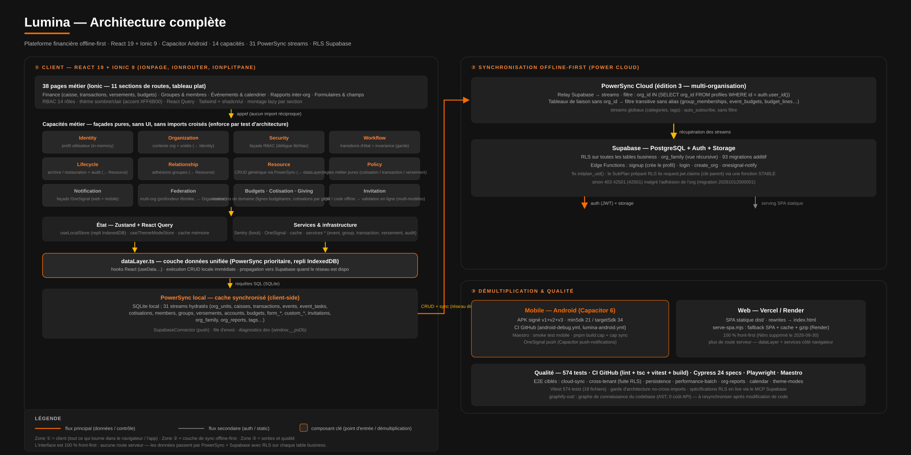

# Lumina



> **Lumina** est une plateforme financière **offline-first** pour les associations (églises, écoles, ONG).
> Toutes les données vivent d'abord **localement** (PowerSync + SQLite / IndexedDB) et se synchronisent
> avec **Supabase** dès que le réseau est disponible. L'interface est une application **React 19 + Ionic 9**
> qui fonctionne aussi bien sur le web que sur mobile Android (Capacitor).

| Métrique | Valeur | État |
|----------|--------|------|
| **Phase** | Plateforme complète (v1.0) | ✅ |
| **Build** | Vite 8, 0 erreur TypeScript | ✅ |
| **Tests unitaires** | 574 tests · 18 fichiers | ✅ |
| **Tests E2E** | Cypress (24 specs) + Playwright + Maestro mobile | ✅ |
| **Capabilities métier** | 14 (10 de base + budgets, cotisation, giving, invitation) | ✅ |
| **Pages Ionic** | 38 routes, toutes en `IonPage` | ✅ |
| **PowerSync** | 31 streams, édition 3 multi-organisation | ✅ |
| **Base de données** | Supabase PostgreSQL · RLS sur toutes les tables · 93 migrations | ✅ |

---

## Table des matières

- [L'application en un coup d'œil](#lapplication-en-un-coup-dœil)
- [Fonctionnalités](#fonctionnalités)
- [Stack technique](#stack-technique)
- [Prérequis](#prérequis)
- [Démarrage local](#démarrage-local)
- [Architecture](#architecture)
  - [Structure du répertoire](#structure-du-répertoire)
  - [Flux des données (offline-first)](#flux-des-données-offline-first)
  - [Couche capabilities](#couche-capabilities)
  - [Synchronisation PowerSync → Supabase](#synchronisation-powersync--supabase)
  - [Base de données](#base-de-données)
- [Variables d'environnement](#variables-denvironnement)
- [Commandes disponibles](#commandes-disponibles)
- [Tests](#tests)
  - [Unitaires (Vitest)](#unitaires-vitest)
  - [E2E web (Cypress)](#e2e-web-cypress)
  - [Mobile (Maestro + CI Android)](#mobile-maestro--ci-android)
- [Déploiement](#déploiement)
  - [Web — Vercel / Render](#web--vercel--render)
  - [Mobile — Capacitor Android](#mobile--capacitor-android)
  - [Base de données — Supabase](#base-de-données--supabase)
  - [CI/CD — GitHub Actions](#cicd--github-actions)
- [Dépannage](#dépannage)
- [Conventions d'architecture](#conventions-darchitecture)
- [Documentation approfondie](#documentation-approfondie)

---

## L'application en un coup d'œil

```
┌────────────────────────────────────────────────────────────────────────────┐
│   NAVIGATEUR / APP ANDROID — React 19 + Ionic 9                           │
│                                                                            │
│   38 pages (finance, groupes, événements, rapports, formulaires, invites) │
│        │  RBAC 14 rôles · thème sombre/clair · React Query · Zustand      │
│        ▼                                                                   │
│   CAPABILITIES — logique métier pure, testable, sans UI                   │
│   identity · organization · security · workflow · lifecycle · relationship│
│   resource · policy · notification · federation + budgets/cotisation/…    │
│        │                                                                    │
│        ▼                                                                    │
│   dataLayer.ts — PowerSync (SQLite) avec repli IndexedDB                  │
└──────────────────────────────┬─────────────────────────────────────────────┘
                               │  sync quand le réseau est là
                               ▼
                   PowerSync Cloud (31 streams, filtrage par org)
                               │
                               ▼
                   Supabase : PostgreSQL + RLS · Auth (email/Google)
                               │            + Storage · Edge Functions
```

## Fonctionnalités

- **💰 Gestion de trésorerie** — caisses, transactions, versements, budgets d'événement et lignes budgétaires, calculs en centimes (pas de flottant).
- **👥 Groupes & membres** — groupes, adhésions, niveaux d'organisation récursifs (organisation → annexes → annexes…), graphes de fédération.
- **📅 Événements & tâches** — calendrier 100 % maison (jour / semaine / mois / année), tâches rattachées (`event_tasks`), suivi des cultes.
- **📑 Rapports inter-organisations** — outbox multi-format (PDF/DOCX/XLSX/PNG), annexes illimitées, réception et preview PDF, RLS récursif via `org_family`.
- **📋 Formulaires avancés** — constructeur de formulaires (`FormBuilder`), saisie (`FormFill`), soumissions, champs personnalisés, modèles (scolaire, entreprise…).
- **💳 Cotisations & dons** — cotisations par groupe (logique dédiée), campagnes de dons et dons.
- **📨 Invitations** — système d'invitation par code / QR (multi-modèles : école, entreprise), pages d'émission, de gestion et de réclamation.
- **🔔 Notifications** — OneSignal (web + mobile), centre de notifications local.
- **🌐 Offline-first** — l'application est utilisable **sans connexion** ; tout est lu/écrit localement puis synchronisé.
- **🎨 Thème** — design tokens Lumina (sombre par défaut, accent `#FF6B00`) mappés en variables CSS Ionic, mode clair parallèle.
- **🔒 Sécurité** — RBAC avec 14 rôles, Row Level Security sur **toutes** les tables, audit trail.

## Stack technique

| Couche | Technologie | Version |
|--------|-------------|---------|
| **Frontend** | React + TypeScript | ^19.2.8 / ^5.9.3 |
| **UI mobile** | Ionic React (iOS mode, split-pane responsive) | ^9.0.2 |
| **Shell mobile** | Capacitor (Android) | ^6.x (CLI ^8.5.2) |
| **Build** | Vite (SWC) | ^8.2.2 |
| **État** | Zustand (local + thème) / React Query (serveur) | ^5.0.15 / ^5.102.8 |
| **Données local-first** | PowerSync Web (@powersync/web + @powersync/react) | ^2.x |
| **Backend** | Supabase (PostgreSQL, Auth, Storage, Edge Functions) | ^2.114.0 |
| **Styling** | Tailwind CSS + shadcn/ui (Radix) + variables Ionic | ^3.4.19 |
| **Formulaires** | React Hook Form + Zod | ^7.87.0 |
| **Graphes & visualisation** | Recharts, @xyflow/react, Recharts | ^2.15.4 |
| **PDF / documents** | pdfjs-dist, react-pdf, docx, jspdf | — |
| **Notifications** | OneSignal (Capacitor Push Notifications) | — |
| **Monitoring** | Sentry (`@sentry/react`) | ^11.4.0 |
| **Tests** | Vitest (unit), Cypress (E2E web), Playwright, Maestro (mobile) | — |
| **Paquet** | pnpm 11 | 11 |

## Prérequis

- **Node.js 22+**
- **pnpm 11** (forcé par le champ `pnpm.version: 11` de `package.json`)
- **Git**
- **Un projet Supabase** (PostgreSQL + Auth + Storage) avec les migrations appliquées
- **Une instance PowerSync Cloud** reliée à ce Supabase (les creds de répllication vivent côté service)
- Optionnel : **Android Studio** pour le build mobile, **Capacitor CLI** (`@capacitor/cli` est déjà en dev-dep)

## Démarrage local

```bash
# 1. Cloner et installer
git clone <url-du-repo>
cd lumina
pnpm install

# 2. Configurer l'environnement
cp .env .env.local      # ou créer .env.local à la main (voir ci-dessous)
```

Les variables requises côté client (prefix `VITE_`) :

| Variable | Description |
|----------|-------------|
| `VITE_SUPABASE_URL` | URL du projet Supabase |
| `VITE_SUPABASE_ANON_KEY` | Clé anon (les politiques RLS protègent les données) |
| `VITE_SUPABASE_JWKS_URL` | URL JWKS pour la vérification des JWT |
| `VITE_POWERSYNC_URL` | Endpoint de l'instance PowerSync |
| `VITE_POWERSYNC_ACCESS_KEY` | Clé d'accès PowerSync (publique côté client) |
| `VITE_ONEAPP_ID` / `VITE_onesignal_app_id` | Identifiant OneSignal (notifications) |
| `VITE_SENTRY_DSN` | DSN Sentry (sinon le SDK reste débranché, sans perte) |

```bash
# 3. Lancer le dev server
pnpm dev               # http://localhost:8080

# 4. Vérifier l'intégrité
pnpm test              # 574 tests unitaires
npx tsc --noEmit       # 0 erreur attendue
```

> **Première utilisation** : créez un compte via `/auth` (signup Supabase), l'edge
> function `signup` crée le profil. Un compte « unconfigured » passe par le
> provisionning d'onboarding (`/onboarding`).

## Architecture

### Structure du répertoire

```
lumina/
├── src/
│   ├── main.tsx                 # Entrée React — initie Sentry, puis App
│   ├── App.tsx                  # Enveloppe IonApp + setupIonicReact()
│   ├── IonicApp.tsx             # IonReactRouter + IonSplitPane (desktop/mobile)
│   ├── AppRouter.tsx            # Garde d'authentification des routes
│   ├── ionic/
│   │   ├── theme.ts / theme.css # Design tokens Lumina → variables CSS Ionic
│   │   └── routes/              # 11 sections de routes (auth, core, finance, …)
│   ├── pages/                   # 38 pages (Dashboard, Finance, Events, Federation, …)
│   ├── components/              # Composants partagés (shadcn/ui + UI métier)
│   ├── capabilities/            # 14 capacités métier pures (voir ci-dessous)
│   │   └── __tests__/          # 574 tests + garde d'architecture
│   ├── store/                   # Zustand (useLocalStore, useThemeModeStore)
│   ├── lib/
│   │   ├── powersync/          # PowerSync Database, SupabaseConnector, schema
│   │   ├── dataLayer.ts        # Couche données unifiée (PS + repli IndexedDB)
│   │   ├── rbac.ts / audit.ts  # Autorisation + traçabilité
│   │   └── *-service.ts        # Services métier (event, group, transaction, …)
│   └── context/
├── supabase/
│   ├── migrations/             # 93 migrations SQL (0000 → 00xx)
│   └── functions/              # Edge Functions (signup, login, create_org, onesignal-notify)
├── powersync/
│   ├── sync-config.yaml        # 31 streams + conventions de filtrage multi-org
│   ├── service.yaml / cli.yaml # Config PowerSync Cloud
│   └── relay.sql               # Relay Supabase → PowerSync
├── cypress/                    # 24 specs E2E web
├── e2e/ e2e-min/ e2e-tests/    # Playwright / magnitude (mobile)
├── android/                    # Projet Capacitor Android (APK signé)
├── scripts/                    # run-cypress.sh, serve-spa.mjs, audit, keystore…
├── .github/workflows/          # ci.yml, cypress.yml, android-*.yml
├── docs/                       # 40+ documents (ONBOARDING, DEPLOYMENT, capabilities…)
└── vercel.json                 # Rewrite SPA → index.html
```

### Flux des données (offline-first)

1. **Tout passe par `src/lib/dataLayer.ts`** — l'unique porte d'entrée/sortie des données.
   - **Écritures** → transaction PowerSync locale (immédiate, même hors ligne),
     propagée vers Supabase par le `SupabaseConnector` quand le réseau est disponible.
   - **Lectures** → SQLite local (PowerSync) ; repli **IndexedDB** (`useLocalStore`)
     pour les données de session quand PowerSync n'est pas encore prêt.
2. **Le navigateur** ne parle jamais directement à PostgreSQL : PowerSync agit comme
   un cache synchronisé, ce qui rend l'app **entièrement fonctionnelle hors ligne**.
3. **Sentry** est branché au boot (`main.tsx`, avant `createRoot`) pour capter les
   erreurs de préchargement ; sans `VITE_SENTRY_DSN`, il reste en mode débranché.

### Couche capabilities

Chaque **capability** est une façade de domaine, **sans UI**, testable de façon isolée.
Les imports inter-capabilities et les imports vers `pages`/`components` sont **interdits**
(enforce par `src/capabilities/__tests__/no-cross-imports.test.ts`).

| Capability | Rôle |
|------------|------|
| `identity` | Profil utilisateur (in-memory) |
| `organization` | Contexte d'organisation + unités |
| `security` | Façade RBAC (délègue à `lib/rbac.ts`) |
| `workflow` | Garde de transitions d'état (immuables) |
| `lifecycle` | Archiver/restaurer avec audit trail |
| `relationship` | Adhésions de groupes |
| `resource` | CRUD générique via PowerSync |
| `policy` | Règles métier (cotisation, transaction, versement) |
| `notification` | Façade OneSignal |
| `federation` | Gestion multi-organisations |
| `budgets` / `cotisation` / `giving` / `invitation` | Extensions de domaine récentes |

Exemple de flux inter-capabilities — **créer une transaction** :

```
Policy.validateAmount(amount)
  → Workflow.transition('transaction', tx, 'PENDING')
  → Security.hasPermission(role, 'transaction:create')
  → dataLayer (PowerSync) → SQLite → Supabase (sync)
```

### Synchronisation PowerSync → Supabase

`powersync/sync-config.yaml` définit **31 streams**. Convention multi-organisation :

- `auth.user_id()` (sous JWT) résout le user contre `profiles` pour récupérer son `org_id`.
- Pour toute table portant `org_id`, le filtre est
  `WHERE org_id IN (SELECT org_id FROM profiles WHERE id = auth.user_id())` —
  `IN` (pas `=`) pour couvrir les utilisateurs multi-org.
- Les tables de liaison **sans** `org_id` (`group_memberships`, `event_budgets`,
  `budget_lines`, `custom_field_values`) sont filtrées **transitivement** par la table
  source qui porte `org_id`, **sans alias** (PowerSync synchrise la ligne source sous
  l'alias, ce qui casserait les requêtes client).
- Les streams globaux (`categories`, `tags`…) restent `auto_subscribe: true` sans filtre.

### Base de données

- **93 migrations** SQL (`supabase/migrations/0000 → 00xx`) couvrent le modèle canonique :
  `profiles`, `org_units`, `transactions`, `caisses`, `versements`, `events`,
  `event_tasks`, `members`, `groups`, `group_memberships`, `accounts`, `budgets`,
  `form_definitions`, `form_submissions`, `custom_fields`, `cotisations`,
  `invitations`, `org_family`, `org_reports`…
- **Row Level Security** est activée sur toutes les tables business ; le schéma est
  **additif** (jamais de modification des tables legacy de l'instance partagée).
- **Edge Functions** : `signup` (crée le profil), `login`, `create_org`, `onesignal-notify`.
- Tableau de comparaison d'index : `docs/DB-INDEX-COMPARISON.md`.

## Variables d'environnement

Le fichier local est `.env.local` (git-ignored). Les clés de déploiement vivent dans les
secrets GitHub Actions — **jamais en clair dans le repo**.

| Variable | Usage |
|----------|-------|
| `VITE_SUPABASE_URL` / `VITE_SUPABASE_ANON_KEY` | Client Supabase (RLS protège) |
| `VITE_SUPABASE_JWKS_URL` | Vérification JWT |
| `VITE_POWERSYNC_URL` / `VITE_POWERSYNC_ACCESS_KEY` | Connexion PowerSync |
| `VITE_ONEAPP_ID` / `VITE_onesignal_app_id` | Notifications OneSignal |
| `VITE_SENTRY_DSN` / `VITE_SENTRY_ENV` | Monitoring Sentry (optionnel) |
| `CYPRESS_TEST_EMAIL` / `CYPRESS_TEST_PASSWORD` | Compte de test E2E (spécifique) |

## Commandes disponibles

| Commande | Description |
|----------|-------------|
| `pnpm dev` | Dev server Vite (http://localhost:8080) |
| `pnpm build` | Build production (web) |
| `pnpm build:dev` | Build en mode development |
| `pnpm build:cap` | Build Capacitor (`CAPACITOR_BUILD=true`) |
| `pnpm sync:cap` | `build:cap` + `cap sync android` |
| `pnpm start` | Serve `dist/` localement (SPA, simulation Render) |
| `pnpm test` | Tests unitaires Vitest (574) |
| `pnpm test:watch` | Vitest en watch |
| `pnpm lint` | ESLint |
| `pnpm audit` | Audit custom (`scripts/audit-lumina.ts`) |
| `pnpm cypress:run` | E2E Cypress (cross-platform, dev server auto) |
| `pnpm cypress:chrome` | E2E sous Chrome |
| `pnpm e2e:smoke` | Smoke test rapide (`simple-check.cy.ts`) |
| `pnpm e2e:full` | Suite E2E complète (`scripts/run-cypress.sh`) |
| `pnpm e2e:min` | Playwright (config `playwright.min.config.ts`) |
| `pnpm debug` | Logcat debug mobile (`scripts/logcat-debug.sh`) |
| `npx tsc --noEmit` | Vérification TypeScript (0 erreur attendue) |
| `npx cap sync android` | Synchronise le build web dans le projet Android |
| `npx cap open android` | Ouvre Android Studio |

## Tests

### Unitaires (Vitest)

```bash
pnpm test                                        # tous les tests
pnpm test src/capabilities/__tests__             # uniquement les capabilities
pnpm test src/capabilities/__tests__/policy.test.ts   # un fichier précis
```

- **574 tests** répartis sur 18 fichiers.
- `no-cross-imports.test.ts` garantit que les capabilities n'importent ni entre elles
  ni vers l'UI — **l'architecture est testée, pas seulement documentée**.
- `e2e.test.ts` couvre des flux inter-capabilities (transaction, archivage, notification).

### E2E web (Cypress)

24 specs dans `cypress/e2e/` : `auth`, `cloud-sync`, `cross-tenant` (leak RLS),
`finance-deep`, `forms-v2`, `groups-events`, `invitations`, `members`, `org-reports`,
`persistence`, `performance-batch`, `calendar`, `responsive-skeleton`, `theme-modes`, …

```bash
# Démarre le dev server si besoin puis lance Cypress
pnpm cypress:run

# Comptes + overrides (voir cypress/support/local.ts)
CYPRESS_TEST_EMAIL=user@test.com CYPRESS_TEST_PASSWORD=pass pnpm cypress:run
```

> Sous Windows, `pnpm cypress:run` utilise le runner Node cross-platform
> (`cypress/run.mjs`) plutôt que le script bash — c'est la voie recommandée.

### Mobile (Maestro + CI Android)

- **Maestro** : flux de smoke test mobile (config dans `skills` + `scripts/*maestro*`).
- **APK signé** : le CI Android (`.github/workflows/lumina-android.yml`,
  `android-debug.yml`) produit un APK signé (v1+v2+v3), `minSdk 21` / `targetSdk 34`.
- Keystore : voir `README-KEYSTORE.md` et `docs/KEYSTORE.md`.

## Déploiement

### Web — Vercel / Render

L'app est 100 % front-first : le build produit un dossier `dist/` statique.

- **Vercel** : `vercel.json` rewrite toute URL vers `index.html` (SPA). Connectez le
  repo et déclenchez un déploiement sur `main`.
- **Render** : `pnpm start` (`scripts/serve-spa.mjs`) sert `dist/` sur `$PORT` avec
  fallback SPA, cache et gzip, sans dépendance externe.

> Les clés d'environnement (`VITE_*`) se définissent dans les secrets de la plateforme.

### Mobile — Capacitor Android

```bash
pnpm build:cap            # build web pour Capacitor
npx cap sync android      # injecte dist/ dans android/
npx cap open android      # ouvre Android Studio → build APK
```

En CI, le pipeline signe l'APK automatiquement et le dépose en artefact GitHub.

### Base de données — Supabase

```bash
# Appliquer les 93 migrations locales au projet Supabase (via MCP / CLI)
supabase db push

# Lister / déployer les edge functions
supabase functions list
```

> Sur cette instance partagée, le schéma **Aurora est additif** : on ne modifie jamais
> les tables legacy, on renomme (préfixe `aurora_`) en cas de collision. RLS et grants
> sont validés par `scripts/rls-verify.sh`.

### CI/CD — GitHub Actions

| Workflow | Rôle |
|----------|------|
| `ci.yml` | Lint + TypeScript + tests unitaires + build (sur chaque PR/push) |
| `cypress.yml` | Suite E2E Cypress sur le dev server |
| `android-debug.yml` / `lumina-android.yml` | Build + signature APK Android |

Le CI installe pnpm **11.27.1** et Node **22** (forcés par `package.json` / `.github`),
crée `.env.local` depuis les secrets et valide la stack complète.

## Dépannage

- **Écran blanc au boot (Ionic)** : `luminaRoutes` DOIT rester un **tableau plat**,
  jamais un `Fragment`. L'engine de vue-stack ne déspareille pas les Fragments — un
  `<>` vide l'outlet. (Correction historique : voir `src/ionic/routes/index.ts`.)
- **Leak RLS inter-tenant** : la spec `cross-tenant.cy.ts` est le garde-fou ; si elle
  échoue, vérifiez les policies `USING (auth.uid() = …)` et les grants `powersync_role`.
- **PowerSync hors ligne / ne sync plus** : vérifiez `VITE_POWERSYNC_URL` + `ACCESS_KEY`,
  et l'état du relay (`powersync/relay.sql`). Le dev expose `window.__psDb` pour
  inspecter `db.status`.
- **Build mobile échoue** : relancez `npx cap sync android` après un `build:cap` ;
  la version Capacitor CLI (`^8.5.2`) corrige la faille `node-tar` sous pnpm 11.
- **Sentry silencieux** : sans `VITE_SENTRY_DSN`, le SDK est débranché (erreur non
  remontée mais app fonctionnelle). Ajoutez le DSN pour activer le remontage.
- **Tests E2E instables** : la plupart des échecs historiques viennent du dev server
  Vite tué par pression mémoire (infrastructure), pas du code. Relancez `pnpm cypress:run`.

## Conventions d'architecture

1. **Pas d'imports inter-capabilities** — chaque capability est isolée (test d'architecture).
2. **Pas de couplage UI** — les capabilities n'importent jamais `@/pages` ou `@/components`.
3. **Singleton par capability** — instance exportée pour la commodité.
4. **Domaine agnostique** — la logique métier évite la terminologie propre à une
   organisation ; le spécifique vit dans `src/lib/` ou l'appelant.
5. **Montants en centimes** — aucune arithmétique flottante sur l'argent.
6. **Schéma additif** — Supabase n'est jamais altéré de façon rétroactive sur l'instance
   partagée ; le RLS protège chaque table business.

## Documentation approfondie

| Document | Contenu |
|----------|---------|
| `docs/ONBOARDING.md` | Guide d'intégration complet + architecture détaillée |
| `docs/DEPLOYMENT.md` | Procédure de déploiement (web + Supabase + mobile) |
| `docs/PLATFORM_COMPLETE.md` | État de la plateforme v1.0 |
| `docs/capabilities/*.md` | Une page par capability (10 de base) |
| `docs/DB-INDEX-COMPARISON.md` | Audit d'index PostgreSQL |
| `docs/security-audit-2026-09-09.md` | Audit sécurité + RLS |
| `docs/ionic-migration.md` | Migration incremental React → Ionic |
| `README-CI.md` | Détail du pipeline CI/CD |
| `README-KEYSTORE.md` / `docs/KEYSTORE.md` | Signature APK Android |
| `AGENTS.md` | Instructions pour les agents de code (architecture front-first) |
| `graphify-out/GRAPH_REPORT.md` | Graphe de connaissance du codebase |

---

_Lumina — finance d'association, pensée pour l'offline, bâtie en capabilities testables._
