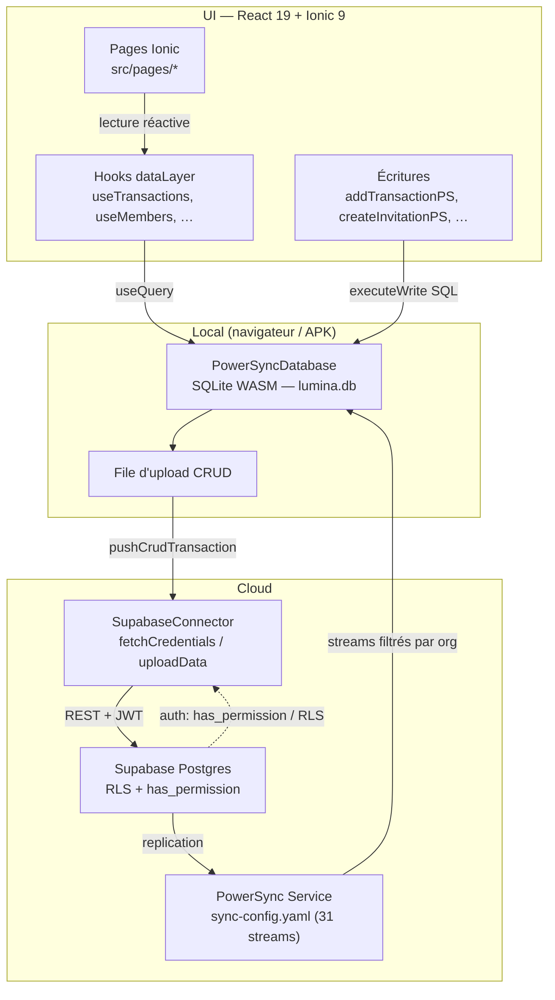

# ARCHITECTURE — Lumina

> Document **dérivé du code réel**. Chaque affirmation technique renvoie à un
> fichier du dépôt. Fiabilité marquée : `[Prouvé]` = lu/vérifié dans le code ou
> mesuré par un gate ; `[Probable]` = cohérent avec plusieurs sources mais non
> exécuté ici ; `[Non vérifié]` = non confirmé.
>
> Dernière mise à jour : 2026-10-28 (phase 16).

## 1. Vue d'ensemble

Lumina est une application **100 % front-first** : React 19 + Ionic 9 + TypeScript,
construite par Vite 8, empaquetée pour Android via Capacitor. Les données vivent
d'abord **localement** (PowerSync 2 sur SQLite/WASM) puis se synchronisent avec
**Supabase Postgres**. Il n'existe **aucune route API serveur** : le plugin Nitro
n'est activé que si `server/` contient de vraies routes `.ts`, ce qui n'est pas le
cas `[Prouvé]` — `vite.config.ts` (`hasNitroRoutesOnDisk()`), `AGENTS.md`.

| Couche | Fichiers | Rôle |
|---|---|---|
| Pages Ionic | `src/pages/*`, montées par `src/ionic/routes/*.tsx` | Écrans (IonPage) |
| Routage | `src/lib/routeResolver.ts`, `src/ionic/routes/index.ts`, `src/App.tsx` | Décision « quelle URL affiche quoi » |
| Couche de données | `src/lib/dataLayer.ts` (≈3865 lignes) | Hooks de lecture + fonctions d'écriture |
| Capacités métier | `src/capabilities/*/index.ts` | Logique de domaine (fédération, invitations, lifecycle…) |
| PowerSync | `src/lib/powersync/*` | Base locale, connector, schéma, streams |
| RBAC | `src/lib/rbac.ts`, `src/lib/permissions.ts`, `src/lib/capabilities.ts`, SQL `has_permission` | Permissions et capacités |
| Auth | `src/lib/auth.ts` (singleton `authService`) | Sessions Supabase |
| Plateforme | `src/main.tsx`, `src/lib/bootWatchdog.ts`, `src/lib/clientErrors.ts` | Boot, watchdog, capture d'erreurs |

## 2. Couches

### 2.1 Pages Ionic et routage

Les routes sont organisées par section sous `src/ionic/routes/`
(`auth`, `core`, `finance`, `groups`, `events`, `members`, `reports`, `forms`,
`invitations`, `admin`, `system`) et concaténées dans un **tableau plat**
`luminaRoutes` `[Prouvé]` — `src/ionic/routes/index.ts`. L'en-tête du fichier
documente l'invariant critique : le tableau **ne doit pas** être un Fragment JSX,
car `React.Children.toArray` aplatit les tableaux mais n'ouvre pas un Fragment,
ce qui rendrait les routes invisibles au moteur de view-stack Ionic (écran blanc).

Le montage se fait dans `src/App.tsx` : un `<IonRouterOutlet>` enveloppe un
`<Routes>` unique, et `/` redirige vers `/splash` via `element={<Navigate …>}`
(un `<Navigate>` enfant d'une `<Route>` sans `element` ne rend rien).

### 2.2 Résolution de route (source de vérité unique)

`src/lib/routeResolver.ts` est un module **pur** (ni React ni I/O) `[Prouvé]`.
Il expose :

- `ROUTE_REGISTRY` : liste de données `{ pattern, kind, permission? }` —
  **64 routes concrètes + 1 catch-all `*`** (comptage du fichier).
- `resolveRoute(pathname, state)` : fonction déterministe renvoyant un
  `RouteOutcome` **fini** : `render` · `redirect` · `needs-auth` ·
  `needs-membership` · `forbidden` · `not-found` · `org-switch-required` ·
  `update-required` · `loading`. Ordre des contrôles : schéma trop ancien →
  route inconnue → route publique → deep link vers une autre org →
  non authentifié → permission manquante → non-membre → render.
- `isAllowedReturnTo()` / `parseDeepLink()` : `returnTo` validé contre une
  **allowlist** (anti open-redirect : refuse `//evil.com` et les URLs absolues).

`src/App.tsx` (composant `RouteGuard`) est l'**unique point d'appel** du
résolveur `[Prouvé]`. Il alimente l'état avec `isAuthenticated`, `activeOrgId`,
`linkOrgId`, `clientSchemaVersion`, `minSchemaVersion`. Les champs
`isOrgMember` et `hasPermission` sont **volontairement non câblés** (voir §2.5) :
la garde structurelle `src/lib/__tests__/route-state-wiring.test.ts` exige que
tout champ de `RouteState` soit soit alimenté, soit inscrit dans `PENDING_WIRING`
avec un id de risque.

Les écrans d'état sont dans `src/components/RouteStates.tsx`, qui définit le
catalogue fini `ScreenStateValue` (`loading`, `ready`, `empty`, `error`,
`offline`, `syncing`, `forbidden`, `notfound`, `partial`, `success`,
`destructive-confirm`) exposé via `data-screen-state`.

### 2.3 Couche de données

`src/lib/dataLayer.ts` est le point d'entrée des données `[Prouvé]`. Deux familles :

- **Lecture** — hooks React (`useTransactions`, `useEvents`, `useMembers`,
  `useGroups`, `useCaisses`, `useAccounts`, `useNotifications`, `useCategories`,
  `useOrgUnits`, `useVersements`, `useEventBudgets`, `useBudgetLines`,
  `useAuditEntries`, `useCotisations`, `useDocuments`, `useGroupMemberships`,
  `useInvitations`, `useInvitationClaims`, `useOrganizations`, `useOrgAdmins`,
  `useEventTasks`…). Ils s'appuient sur `useQuery` / `usePowerSync` de
  `@powersync/react` et sur l'organisation active (`src/lib/orgContext.ts`).
- **Écriture** — fonctions `*PS` (`addTransactionPS`, `updateMemberPS`,
  `createInvitationPS`, `createGrantPS`, `createOrganizationPS`…) qui exécutent
  du SQL local via `executeWrite()` (`db.execute`) ; PowerSync place ensuite
  l'op dans sa file d'upload.

Le contexte d'organisation (`src/lib/orgContext.ts`) est réactif :
`subscribeOrganization()` re-rend les hooks quand l'org résolue change, et la
valeur est relue **synchroniquement** depuis `localStorage["lumina-active-org"]`
au chargement du module pour éviter un premier rendu sur `__no_org__` (listes
vides trompeuses).

### 2.4 Couche « capabilities »

`src/capabilities/` regroupe la logique métier par domaine, chaque dossier
exposant un `index.ts` `[Prouvé]` :
`budgets`, `cotisation`, `federation`, `giving`, `invitation`, `lifecycle`,
`notification`, `organization` (+ `central.ts`), `policy`, `relationship`,
`resource`, `security`, `workflow`.

`src/capabilities/security/index.ts` est une **façade** : il ré-exporte
`PERMISSION_MATRIX`, `ROLE_LABELS`, `ROLE_HIERARCHY` depuis `src/lib/rbac.ts`
et ne redéfinit rien (règle inscrite en tête de fichier).

### 2.5 RBAC

Modèle à **trois niveaux**, décrit dans `docs/agent/CONTRAT_RBAC.md` :

1. **Rôles canon** — `PERMISSION_MATRIX` (`src/lib/rbac.ts`) : 14 rôles ×
   28 permissions `resource:action`.
2. **Décision unique** — `has_permission(uid, org, resource, action, scope_res,
   scope_id)` en SQL (migration `20261026000002_rbac_has_permission.sql`) et son
   miroir TS `evaluatePermission()` (`src/lib/permissions.ts`). Règles
   identiques : **deny prioritaire** → rôle canon actif → grant allow actif →
   refus. La table `role_permissions` est **générée** depuis `PERMISSION_MATRIX`
   (le test `role-model-drift.test.ts` verrouille l'égalité TS↔SQL↔instantané).
3. **Capacités lisibles** — `src/lib/capabilities.ts` : 14 capacités
   (`finance.manage`, `invitations.manage`, `admin.roles`…) mappées à une ou
   plusieurs permissions. `capabilitiesForRole` = « au moins une » permission
   (affichage) ; `capabilityFullyGranted` = « toutes ».

Les `grants` sont **cloisonnés par organisation** : colonne `org_id NOT NULL`
et policies `grants_read_org` / `grants_insert_admin` / `grants_update_admin`
(migration `20261027000010_grants_org_scope.sql`). `has_permission` contraint
chaque grant à `g.org_id = p_org`.

**État ouvert** : `profiles.role='ADMIN'` existe en données/RLS mais est absent
du modèle canon → le compte admin central n'obtient aucun droit via
`has_permission` (risque **R109**, décision propriétaire). C'est pourquoi
`isOrgMember` / `hasPermission` ne sont pas câblés dans `App.tsx` (R105/R107) :
un câblage naïf enfermerait dehors les admins.

### 2.6 Authentification

`src/lib/auth.ts` (singleton `authService`) est la seule source de vérité
`[Prouvé]`. Client Supabase créé avec `persistSession: true` (clé
`sb-<projectRef>-auth-token`) et `flowType: "pkce"`. La **déconnexion est
douce** : `signOut()` n'appelle **pas** `supabase.auth.signOut()` (qui révoque
le refresh token côté serveur) ; il sauvegarde les tokens sous
`lumina-session-backup` et retire la clé locale. `restoreSoftSession()` rejoue
`refreshSession({ refresh_token })` — chemin utilisé par `/sessions`.

### 2.7 PowerSync

`src/lib/powersync/index.ts` crée le **singleton** `PowerSyncDatabase`
(`lumina.db`) et le `SupabaseConnector` `[Prouvé]`. Points notables :

- `initPowerSync()` est **idempotent** ; il **miroite** la session du client
  Supabase applicatif dans le client du connector (sinon `fetchCredentials()`
  renvoie `null` après login → sync refusée).
- Les streams **on-demand** (`auto_subscribe: false`) sont souscrits
  explicitement via `ON_DEMAND_STREAMS` (12 entrées), sinon les tables locales
  restent vides.
- `SupabaseConnector.ts` implémente `fetchCredentials()` et `uploadData()` ;
  `pushCrudTransaction()` filtre les colonnes hors schéma client et applique
  des `NOT_NULL_DEFAULTS` (jamais de défaut pour `org_id`, colonne d'isolation).
  Les codes Postgres fatals (`22xxx`, `23xxx`, `42501`) ne sont pas retentés.

`src/lib/powersync/schema.ts` déclare le schéma client (tables + colonnes) ;
les schémas annexes vivent dans `invitation-schema.ts`, `org-admin-schema.ts`,
`org-reports-schema.ts`, `multi-org-schema.ts`.

## 3. Flux de données (offline-first)

Explication `[Prouvé]` :

1. **Lecture** : les hooks interrogent la base **locale** (SQLite) via PowerSync ;
   l'UI est réactive aux changements locaux, indépendamment du réseau.
2. **Écriture** : `executeWrite()` écrit en SQLite local, PowerSync empile l'op,
   puis `SupabaseConnector.uploadData()` pousse la transaction vers Supabase
   (REST, JWT de l'utilisateur → RLS).
3. **Descente** : le service PowerSync (`powersync/sync-config.yaml`, **31
   streams**, édition 3, `auth.user_id()`) réplique vers le client les lignes
   filtrées par organisation. **12 streams** sont `auto_subscribe: false` et
   doivent être souscrits par le client (`ON_DEMAND_STREAMS`). La garde
   `sync-streams-drift.test.ts` verrouille l'égalité des deux listes.

## 4. Configuration de synchronisation

`powersync/sync-config.yaml` est l'unique source de vérité des streams (édition 3)
`[Prouvé]`. Convention de filtrage : pour toute table portant `org_id`,
`WHERE org_id IN (SELECT org_id FROM profiles WHERE id = auth.user_id())`.
Les tables de liaison sans `org_id` (`group_memberships`, `event_budgets`,
`budget_lines`, `custom_field_values`) sont filtrées par jointure via leur
parent. `service.yaml` est l'unique source de vérité du service config Cloud.

## 5. Décisions structurantes (ADR)

Les décisions d'architecture sont consignées dans `docs/agent/DECISIONS.md`
(ADR D1…, D-07…, D-P4-1…). Les plus structurantes :

| ADR | Décision |
|---|---|
| D1 | Environnement cible = dev/test (`hhgovvrnalibhgpakswi`), pas de prod réelle. |
| D-10/D-11 | Inscription **sans** organisation (`__no_org__`) ; un sentinelle n'est pas une org. |
| D-12 | Fédération via fonction `SECURITY DEFINER` (`org_descendants`), pas de lecture de vue en policy (évite la récursion). |
| D-13 | `profiles.role` modifiable uniquement par un administrateur d'organisation. |
| D-P4-1 | Décision de permission **unique**, générée depuis la matrice canon (DB↔TS). |
| D-P4-3 | `has_permission` livrée comme primitive ; RLS non réécrites (chantier ouvert). |
| D-S6-1 | Ne pas élargir le stream `profiles` malgré le défaut R80. |
| D-S10-1 | Ne pas trancher le rôle `ADMIN` en autonomie (conservateur, R109). |
| D-S11-1 | Durcir la surface RPC par l'**état final** (ordre des migrations), pas par motif. |
| D-P8-1 | Aucune fonction de trigger ni de règlement exposée en RPC (voir `SECURITY.md`). |

## 6. Limites connues

- **Pas de route serveur** : toute la logique d'autorisation fine repose sur la
  RLS Postgres et sur `has_permission` (défense en profondeur côté client = garde
  de route, partiellement inerte — R105/R107).
- **R109** (rôle `ADMIN`) et **R16** (divergence `profiles.role` ↔
  `org_memberships.role`) restent à trancher par le propriétaire.
- **R98** : la suite Cypress n'est jamais verte sur `main` (environnement E2E) —
  voir `TESTING.md`.

## 7. Renvois

- Sécurité (RLS, `SECURITY DEFINER`, PII, secrets) → [`SECURITY.md`](./SECURITY.md)
- Stratégie de test et gates → [`TESTING.md`](./TESTING.md)
- Décisions détaillées → `docs/agent/DECISIONS.md`
- Risques → `docs/agent/RISQUES.md`
- Contrat RBAC → `docs/agent/CONTRAT_RBAC.md`
